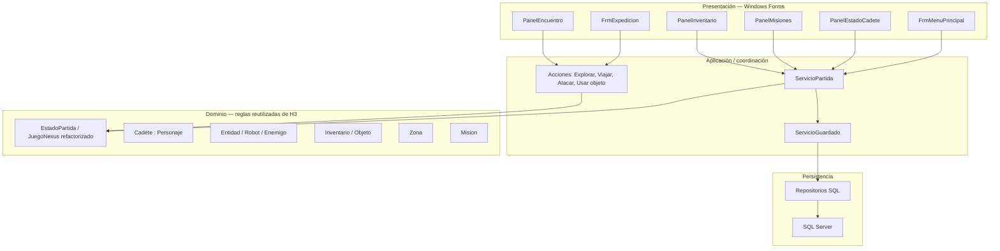

# Arquitectura propuesta para la versión gráfica de NEXUS

## Objetivo

Evolucionar la solución de consola H3 hacia un videojuego gráfico de escritorio en C# con Windows Forms y partidas persistentes en SQL Server. La propuesta conserva las reglas y tipos de `Program.cs`; los elementos con prefijo `Propuesto` son nuevos y no están implementados todavía.

## Capas y dependencias

Dirección recomendada: los formularios solicitan acciones a un servicio de aplicación; el dominio valida y modifica la partida; el servicio de guardado traduce el estado a repositorios SQL. El dominio no debe referenciar `System.Windows.Forms`, ni ejecutar consultas. Los formularios no deben duplicar reglas ni construir SQL en sus manejadores de eventos.

## Asignación de responsabilidades y relación con H3

| Componente | Acción de evolución |
|---|---|
| `Personaje`, `Cadete`, `Entidad`, `Robot`, `Enemigo` | Mantener las reglas y datos de H3; extraer los mensajes de consola de métodos de dominio para que la UI los presente. |
| `Objeto`, `Inventario` | Mantener operaciones de colección y reglas de objetos; introducir códigos estables de objeto para persistencia e icono/etiqueta en presentación. |
| `Zona`, `Mision` | Mantener nodos y condiciones de misión; usar identificadores de zona/misión en lugar del índice como identidad persistente. |
| `JuegoNexus` | Refactorizarlo en estado de partida y casos de uso pequeños: explorar, viajar, administrar inventario, procesar encuentro, consultar estado y completar misión. Inyectar fuente aleatoria para permitir encuentros reproducibles en futuras pruebas. |
| `FrmMenuPrincipal` (nuevo) | Nueva expedición, cargar una ranura, configuración mínima y salir. |
| `FrmExpedicion` (nuevo) | Mapa, área de exploración, registro de eventos y navegación a paneles. |
| `PanelEstadoCadete`, `PanelMisiones`, `PanelInventario`, `PanelEncuentro` (nuevos) | Mostrar proyecciones del estado; enviar acciones al servicio, sin contener reglas. Pueden ser UserControls dentro de la ventana principal. |
| `ServicioPartida` (nuevo) | Ejecutar una acción completa y devolver resultado/estado actualizado a la presentación. |
| `ServicioGuardado`, `IPartidaRepository`, repositorios SQL (nuevos) | Guardar/recuperar snapshot de expedición con una transacción; ocultar ADO.NET de las reglas. |

### Secuencia de una acción

1. El jugador pulsa “Explorar”; `FrmExpedicion` llama `ServicioPartida.Explorar()`.
2. El servicio invoca la regla existente refactorizada. El dominio valida energía, resta 10 y resuelve el evento.
3. El servicio devuelve un resultado tipado (evento, cambios de energía/salud, mensaje y objetivos actualizados).
4. La pantalla actualiza mapa, barras y registro. Si el jugador activó guardado automático o explícito, `ServicioGuardado` guarda el snapshot por repositorios.
5. Un error de base de datos se presenta como problema de guardado; no debe revertir visualmente una acción ya aplicada sin explicar la diferencia entre memoria y disco.

## Estrategia de migración

1. **Estabilizar el comportamiento:** compilar y entender H3, registrar reglas y crear casos de uso sin cambiar valores; aclarar la regla de escapar antes de declarar la misión.
2. **Desacoplar consola:** sacar mensajes y lecturas de `Console`; hacer que las acciones acepten decisiones y devuelvan resultados. Mantener una consola de referencia temporal si ayuda a comparar.
3. **Crear solución WinForms:** añadir proyecto de escritorio compatible con el framework seleccionado; mantener el dominio sin referencias a UI. Construir menú y pantalla de expedición con controles estándar.
4. **Conectar servicios de datos:** definir esquema, scripts versionados, repositorios SQL y guardar/cargar transaccional.
5. **Pulir y verificar:** revisar recorridos de nueva partida, bloqueo de zona, consumo de objetos, muerte, victoria, interrupción, error de conexión y recuperación tras reinicio.

Se recomienda mantener inicialmente .NET Framework 4.8 para no combinar un cambio de plataforma con el cambio de interfaz. Una migración posterior a .NET moderno puede evaluarse aparte, cuando el entorno de Visual Studio y requisitos del curso estén confirmados.

## Manejo de estado y errores

El estado canónico vive en el dominio. Los controles leen y muestran ese estado; no son su almacenamiento. La acción devuelve un resultado que permite presentar costos y consecuencias. Al cargar, se valida versión y relaciones; un guardado incompleto debe revertirse mediante transacción. La cadena de conexión se configura fuera del código compartido y no se almacena con credenciales en GitHub.

## Ventajas, límites y criterios de aceptación

**Ventajas:** reutiliza reglas de H3, permite cambiar UI sin reescribir el dominio, reduce la mezcla de lógica y salida, acota operaciones SQL, y hace posible probar reglas sin abrir formularios.

**Límites:** WinForms es una interfaz de escritorio Windows, no una plataforma móvil; requiere instalación de SQL Server/instancia y configuración local; la arquitectura no convierte el juego automáticamente en “gráfico 3D” ni incluye arte, animación o multijugador.

**Criterios de aceptación de la etapa gráfica:** se puede iniciar, explorar, moverse por adyacencia, ver objetivos/estado/inventario, resolver encuentro con acciones H3 y completar/abandonar/perder partida sin reglas duplicadas en formularios. La etapa de datos se acepta cuando guardar, cerrar, abrir y cargar reconstruye zona, recursos, objetos y misión de forma consistente.
