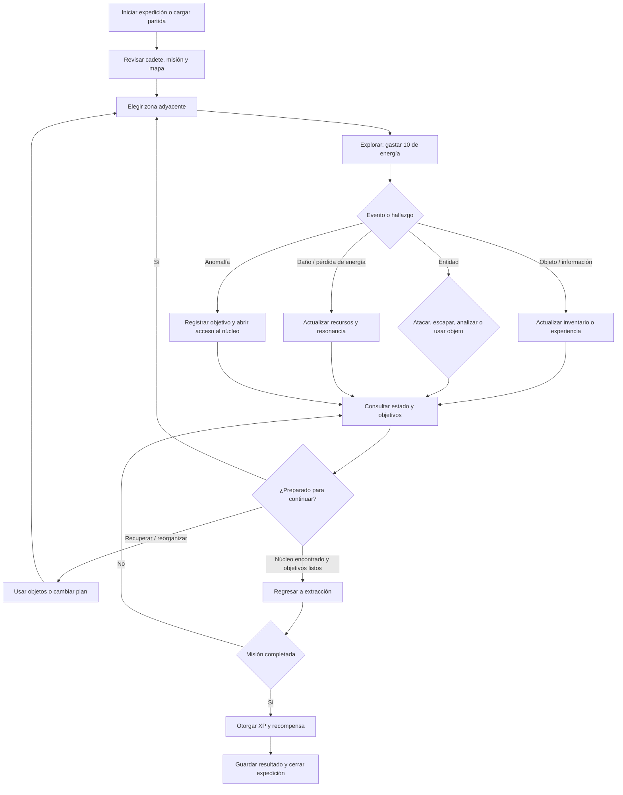

# NEXUS: diseño de la experiencia de juego

**Base de diseño:** entrega H3 incluida en `NEXUS_entrega_inicial.zip` y código `Program.cs`.  
**Estado:** diseño de evolución; las pantallas descritas son bocetos, no formularios implementados.

## Visión del juego

NEXUS es una aventura de exploración y supervivencia ambientada en 2297. El jugador encarna a un cadete enviado a una dimensión inestable para localizar una anomalía, recuperar su núcleo energético y volver al punto de extracción. La experiencia combina exploración con riesgo, decisiones de gasto de recursos y encuentros que pueden resolverse luchando o escapando.

El juego debe hacer sentir que cada expedición avanza hacia un objetivo claro y que el jugador controla el riesgo: explorar consume energía, los hallazgos pueden preparar al cadete y la resonancia creciente hace más peligroso el entorno. El progreso —objetivos registrados, objetos útiles y experiencia ganada— es la razón para continuar y regresar a salvo. La victoria de H3 exige investigar la grieta, encontrar el núcleo, sobrevivir un encuentro y volver a extracción.

La versión final conservará esa identidad y convertirá la consola en una aventura gráfica de escritorio. El mapa, el estado y la misión estarán visibles mientras se juega; las acciones seguirán siendo las reglas de H3. No se propone cambiarlo a un juego de acción en tiempo real ni introducir sistemas que no tengan base en la expedición existente.

## Ciclo principal de juego

La secuencia de H3 tiene cinco zonas ordenadas: Punto de Extracción, Bosque de Cristal, Laboratorio Abandonado, Grieta de Resonancia y Núcleo de la Anomalía. El jugador solo se desplaza a zonas adyacentes; el acceso al núcleo se habilita al investigar la grieta. El juego termina al completar la misión, perder al cadete o abandonar la expedición.

## Mecánicas y reglas

| Sistema | Regla verificada en H3 | Presentación e interacción propuesta |
|---|---|---|
| Exploradores | Hay un cadete con nombre, salud, energía, ataque, escudos y experiencia. Salud inicial 100, ataque 20, energía 100. | Tarjeta persistente del cadete con barras numéricas y texto; el estado nunca dependerá solo del color. |
| Mapa | Cinco zonas en una lista lineal. El desplazamiento permite solo el índice actual ±1. El núcleo (zona 5) requiere haber investigado la anomalía. | Mapa de nodos conectados; zona actual resaltada y destinos bloqueados explicados. Botón de viajar activo solo para vecinos permitidos. |
| Energía | Explorar cuesta 10; atacar cuesta 5; escapar cuesta 5. Hallazgos pueden recuperar energía; algunos eventos la reducen. | Mostrar costo antes de confirmar y la energía restante inmediatamente después. Si no alcanza, explicar el motivo. |
| Resonancia | Aumenta al investigar anomalía, recuperar núcleo, explorar y recibir eventos de daño; se limita a 100. En 70+, aumenta la probabilidad de daño del evento. | Medidor con valor /100, etiqueta de riesgo y mensaje al cruzar umbrales. |
| Eventos | H3 usa `Random`: objeto, entidad, pérdida de energía, daño, información o ningún hallazgo. Sus probabilidades son parte del código y no promesa de equilibrio. | Registro de evento con icono y texto; no bloquear navegación con mensajes fugaces. |
| Misiones | Una misión “La anomalía perdida” registra anomalía investigada, núcleo encontrado y encuentro sobrevivido; se completa al volver a extracción. Otorga 100 XP y un módulo. | Lista de objetivos con estados pendiente/completo y siguiente paso sugerido. |
| Encuentros | Aparece un `Robot` o `Enemigo`. Opciones: atacar, escapar, analizar con Analizador, usar objeto. Ganar combate otorga 20 XP. | Panel de encuentro separado dentro de Exploración; vida del rival y acciones disponibles visibles. Confirmar antes de consumir recurso. |
| Inventario | Los objetos incluyen célula de energía (+25), escudo, módulo de ataque (+10), Analizador, núcleo y módulo desconocido. El núcleo y recompensa no se consumen; el núcleo no se elimina. | Cuadrícula/lista con nombre, descripción, cantidad y acción contextual. Distinguir objetos de misión de consumibles. |
| Progresión | XP se obtiene por información, derrotar entidad y completar misión; hay mejoras de ataque mediante objeto. | Resumen al ganar XP y recompensa; no inventar árboles de habilidades para la primera entrega. |
| Persistencia | H3 solo guarda el estado en memoria durante el proceso; no hay guardado en archivo ni SQL. | Propuesta: guardar/cargar un espacio de expedición desde SQL Server, con confirmación de éxito o error. |

### Ajuste de regla que debe resolverse al implementar

En `EncontrarEntidad()`, el método registra `EncuentroSobrevivido` si el cadete sigue vivo después del bucle, incluso cuando el jugador eligió escapar. La versión final debe decidir si “sobrevivir” significa cualquier salida con vida o neutralizar al rival. Para conservar la literalidad de H3, esta propuesta mantiene “salir con vida” como condición; la interfaz debe decirlo explícitamente y el código debe separar escape de victoria si la intención narrativa fuera otra.

## Diseño de pantallas y navegación

Los bocetos detallados de menú, mapa, misión e inventario están en [evidencias/bocetos.md](evidencias/bocetos.md). La navegación propuesta usa una ventana principal con barra superior de estado y panel central intercambiable. Menú inicia o carga; mapa permite moverse y explorar; pestañas o botones laterales abren Misiones e Inventario; un encuentro ocupa el panel central sin ocultar salud y energía. “Volver” regresa a la pantalla anterior y “Salir” solicita confirmación si hay progreso sin guardar.

## Experiencia de usuario

- **Legibilidad:** tipografía de interfaz de al menos 12 pt en el tamaño normal de escritorio; textos de misión y descripción legibles sin depender de abreviaturas. El contraste debe distinguir texto, fondos, controles y estados.
- **Jerarquía visual:** primero objetivo actual y zona; después salud/energía/resonancia; luego acciones principales; registro e inventario detallado quedan en segundo plano.
- **Consistencia:** los botones mantienen nombres y posición; los verbos “Explorar”, “Viajar”, “Usar”, “Guardar” y “Volver” conservan el mismo significado en todas las pantallas.
- **Navegación:** el jugador siempre sabe dónde está, qué objetivo falta y cómo regresar. Deshabilitar un control no basta: incluir una explicación.
- **Retroalimentación:** cada acción confirma su resultado, costo, cambio de estadística y avance de objetivo; los errores ofrecen una salida concreta.
- **Accesibilidad básica:** navegación con teclado, foco visible, atajos coherentes, etiquetas accesibles y estados expresados mediante texto además de color.
- **Protección del progreso:** guardar/cargar se distingue de abandonar; confirmar al reemplazar o descartar una partida.

## Alcance y restricciones

### Prioridad para la primera versión gráfica

1. Menú para nueva expedición, cargar, guardar y salir.
2. Mapa con cinco zonas, movimiento adyacente y acceso condicional al núcleo.
3. Vista de exploración, registro de eventos y encuentro por turnos con las cuatro acciones H3.
4. Paneles de estado, misión e inventario, respetando los efectos actuales.
5. Separación entre formularios y reglas para que la interfaz no sea dueña del estado de juego.
6. SQL Server para guardar y recuperar una partida con cadete, zona, recursos, objetos y objetivos de misión.

### Opcional después de validar el ciclo base

- Animaciones y arte final, música/sonido, mapa ilustrado, más misiones o zonas.
- Configuración de dificultad, tutorial interactivo y localización.
- Historial de expediciones y varias ranuras de guardado.

### Restricciones

- Mantener C#, Windows Forms y SQL Server como tecnologías objetivo.
- Partir de las clases y reglas reales de H3; no afirmar que la propuesta ya está implementada.
- La entrega actual es una aplicación de consola .NET Framework 4.8 en un único `Program.cs`; no contiene formularios, acceso a datos ni guardado persistente.
- No publicar contraseñas ni cadenas de conexión con credenciales. Probar con una instancia local autorizada.
- Primero migrar la lógica sin cambiar resultados; luego construir UI y finalmente añadir persistencia. No intentar reescribir todo en una sola fase.
- La versión de SQL Server y del proveedor cliente deben fijarse al preparar la implementación según el entorno disponible.
