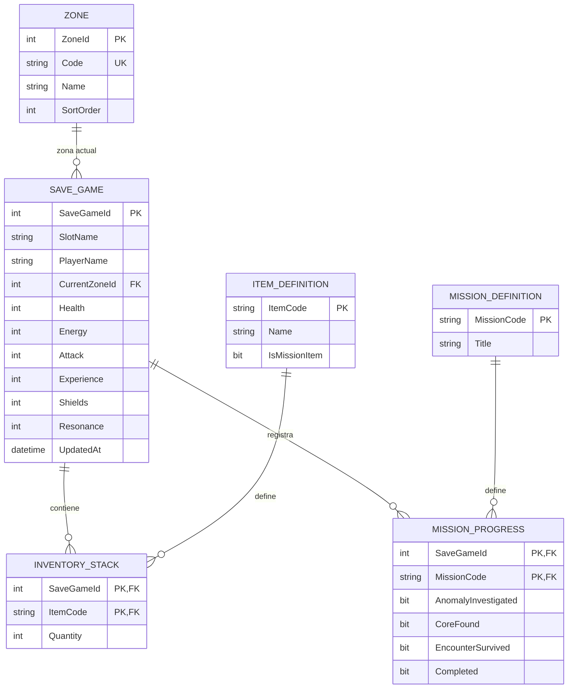

# Modelo de datos propuesto para guardar partidas de NEXUS

## Propósito y límites

H3 conserva todo el estado en memoria. Este modelo propone persistencia relacional para una expedición individual local mediante SQL Server. Es un diseño futuro; no existe aún base de datos, script de migración ni código ADO.NET en la entrega revisada.

## Entidades

| Tabla | Clave y campos propuestos | Relación / finalidad |
|---|---|---|
| `SaveGame` | `SaveGameId int IDENTITY PK`, `SlotName nvarchar(60)`, `PlayerName nvarchar(50)`, `GameVersion nvarchar(20)`, `CreatedAt datetime2`, `UpdatedAt datetime2`, `CurrentZoneId int FK`, `Health/Energy/Attack/Experience/Shields int`, `Resonance int`, `IsActive bit` | Raíz del snapshot de una ranura. Los atributos corresponden a `Cadete` y `JuegoNexus`; un guardado representa una expedición. |
| `Zone` | `ZoneId int PK`, `Code nvarchar(40) UNIQUE`, `Name nvarchar(100)`, `Description nvarchar(500)`, `SortOrder int`, `IsUnlockedByDefault bit` | Catálogo estable de las cinco `Zona` de H3; permite guardar identidad, no depender del índice de una lista. |
| `ItemDefinition` | `ItemCode nvarchar(40) PK`, `Name nvarchar(100)`, `Description nvarchar(500)`, `IsMissionItem bit`, `IsConsumable bit` | Catálogo para célula, escudo, módulo de ataque, Analizador, núcleo y módulo desconocido. |
| `InventoryStack` | `SaveGameId int FK`, `ItemCode nvarchar(40) FK`, `Quantity int CHECK (Quantity > 0)`, PK (`SaveGameId, ItemCode`) | Objetos que pertenecen al inventario de una ranura. Agrega instancias repetidas de `List<Objeto>` en una cantidad. Si después cada instancia adquiere estado propio, pasar a una tabla por instancia. |
| `MissionDefinition` | `MissionCode nvarchar(40) PK`, `Title nvarchar(120)`, `Description nvarchar(1000)` | Catálogo; en H3 hay una misión “La anomalía perdida”. |
| `MissionProgress` | `SaveGameId int FK`, `MissionCode nvarchar(40) FK`, `AnomalyInvestigated bit`, `CoreFound bit`, `EncounterSurvived bit`, `Completed bit`, PK (`SaveGameId, MissionCode`) | Reproduce las banderas de `Mision`. Una fila por misión activa en una ranura. |

## Diagrama entidad-relación

## Reglas de integridad

- Claves foráneas impiden guardar una zona, objeto o misión que no exista en su catálogo.
- Restricciones `CHECK` deben mantener `Health`, `Energy`, `Shields`, `Experience`, `Resonance` en rangos válidos; los topes de energía/salud deben seguir las reglas de dominio, no depender solo de SQL.
- `InventoryStack.Quantity > 0`; eliminar el último ejemplar elimina la fila.
- La finalización de misión requiere anomalía investigada, núcleo encontrado y encuentro sobrevivido; la regla exacta de escapar se debe acordar y compartir entre dominio y UI.
- `CurrentZoneId` es una referencia, mientras que desbloqueos futuros requerirían una tabla `SaveZoneProgress` si ya no bastan las condiciones actuales.
- La versión de guardado permite detectar partidas antiguas y migrarlas o rechazarlas con explicación.

## Guardar y recuperar

**Guardar:** validar el estado en la lógica; iniciar transacción; insertar/actualizar `SaveGame`; reemplazar las filas de `InventoryStack`; actualizar `MissionProgress`; confirmar transacción. Si falla una escritura, ejecutar rollback para que el snapshot anterior permanezca completo. Las consultas deben parametrizar valores y usar el mismo identificador de guardado.

**Recuperar:** consultar `SaveGame` por ranura; obtener zona, inventario y progreso relacionado; validar versión y valores; reconstruir `Cadete`, `Inventario`, `Zona` y `Mision`; presentar la expedición restaurada. Si falta una definición referenciada o la base no está disponible, mostrar error recuperable sin ocultar que no se cargó.

**Borrado:** eliminar ranura en una sola operación con integridad referencial controlada (cascada intencional o borrado explícito en transacción). Pedir confirmación en la UI.

## Acceso y seguridad

La capa de repositorios usará parámetros SQL y tipos/tamaños explícitos. No concatenar nombres ni valores del jugador en SQL. Mantener la conexión abierta solo durante la operación, manejar excepciones concretas y no escribir contraseñas en `App.config` versionado. Para una instalación local se configurará una instancia SQL Server elegida por el curso; el nombre de instancia y método de autenticación quedan pendientes del entorno de implementación.

## Correspondencia con H3 y evolución

`Cadete` aporta los atributos de estado; `JuegoNexus` aporta zona actual y resonancia; `Inventario` aporta la colección de objetos; `Mision` aporta los cuatro indicadores. `Zona` y `Objeto` necesitan códigos estables porque en H3 solo llevan nombre/descripción. No se guardan entidades de combate transitorias en la primera versión: solo se persiste al acabar una acción completa, y la entrega H3 no define reanudar a mitad de turno.

## Decisiones aún por cerrar al implementar

Cantidad de ranuras, una o varias partidas por jugador, edición/versión exacta de SQL Server, política de guardado automático, migración de esquema y si se guardará un encuentro activo. Estos puntos no cambian el modelo mínimo y deben decidirse junto al entorno de ejecución.
